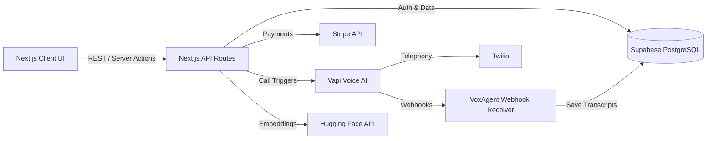
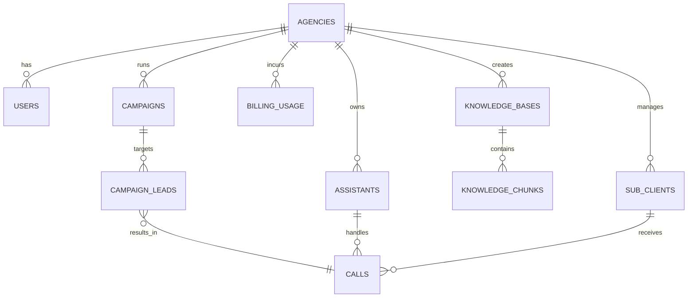

# VoxAgent

> A production-ready, multi-tenant B2B SaaS platform for creating, managing, and reselling AI-powered voice receptionists and outbound dialers under a white-label brand.

---

## 2. Project Overview

VoxAgent is a highly scalable, multi-tenant software-as-a-service (SaaS) platform built for marketing agencies, sales teams, and enterprise businesses. It allows users to orchestrate complex voice AI operations—such as handling inbound customer support or executing bulk outbound sales calls—without writing a single line of code.

By abstracting the complexities of telecommunications (Twilio), conversational AI orchestration (Vapi), and semantic search (Hugging Face / pgvector), VoxAgent provides a unified, white-labeled dashboard. Agencies can onboard their own clients, set up customized AI assistants, and bill them dynamically based on usage.

---

## 3. Problem Statement

Small to medium-sized businesses (SMBs) miss up to 30% of inbound calls, resulting in lost revenue. Simultaneously, scaling outbound sales teams (BDRs/SDRs) is expensive and slow. 

While powerful voice AI APIs like Vapi and Retell exist, they present a significant **technical barrier**. They are built for developers, not for business owners or agencies. Furthermore, existing AI voice platforms lack **true multi-tenancy and white-labeling**, forcing agencies to sell third-party branded solutions rather than building their own brand equity. 

Agencies need a way to instantly deploy AI voice infrastructure for their clients securely, reliably, and under their own domain, with built-in billing and analytics.

---

## 4. Solution

VoxAgent solves this by providing a "business-in-a-box" SaaS architecture. It orchestrates the underlying AI and telecom APIs while providing a secure, isolated environment for each agency and its sub-clients.

**System Workflow:**
1. An agency configures an AI Assistant with custom prompts and a Knowledge Base (PDFs/TXTs).
2. The agency uploads a CSV of leads to a Campaign.
3. The Next.js API securely retrieves the encrypted API keys and dispatches parallel call requests to Vapi.
4. Vapi handles the real-time LLM interaction and Twilio telephony.
5. Post-call, Vapi sends a webhook back to VoxAgent, which securely updates the Supabase database with the call transcript, status, and billing usage.



---

## 5. Key Features

* **Multi-Tenant White-labeling:** Agencies can upload their logos, set brand colors, and use custom domains. Data is strictly isolated via PostgreSQL Row Level Security (RLS).
* **No-Code AI Configuration:** Users can define AI behavior, select from multiple voices, and configure system prompts directly from the UI.
* **Knowledge Base (RAG):** Users can upload documents which are chunked, vectorized via Hugging Face, and stored in `pgvector` for the AI to perform semantic search during calls.
* **Bulk Outbound Campaigns:** Upload CSV leads and trigger hundreds of parallel outbound calls automatically.
* **Automated Fallbacks:** If a call is unanswered, the system automatically triggers an SMS or WhatsApp fallback message to the lead.
* **SaaS Billing & Subscriptions:** Integrated with Stripe for monthly subscriptions and minute top-ups with atomic balance deduction.
* **Real-time Analytics:** Track call volume, minutes used, and success rates, viewing live transcripts as calls happen.

---

## 6. Technology Stack

| Technology | Purpose |
|------------|---------|
| **Next.js 16 (App Router)** | Fullstack Framework (Frontend UI + API Routes) |
| **React 19** | UI Library utilizing Server Components (RSC) |
| **Tailwind CSS v4** | Utility-first styling for the Glassmorphism UI |
| **Supabase** | PostgreSQL Database, Auth, Storage, and Realtime subscriptions |
| **pgvector** | PostgreSQL extension for storing and querying vector embeddings |
| **Vapi** | Conversational AI Voice Engine orchestration |
| **Hugging Face API** | Generating text embeddings for the Knowledge Base |
| **Stripe** | Subscription management and usage-based billing |
| **Docker / Docker Compose** | Local containerized development (Supabase local stack) |

---

## 7. Architecture

VoxAgent follows a **Serverless Edge Architecture** optimized for Next.js and Vercel.

* **Client Layer (RSC & Client Components):** Utilizes React Server Components for fast initial page loads and SEO, mixed with Client Components (Zustand, Framer Motion) for interactive dashboards.
* **API / Service Layer (Next.js API Routes):** Acts as the secure orchestrator. It handles business logic, decrypts API keys, checks billing balances, and communicates with external APIs (Vapi, Stripe).
* **Persistence Layer (Supabase/PostgreSQL):** The single source of truth. All data access is mediated through Row Level Security (RLS) policies ensuring strict tenant isolation.
* **Webhook Layer:** Asynchronous endpoints (`/api/webhooks/*`) that receive out-of-band updates from Vapi (call transcripts) and Stripe (payment success), updating the database safely.

---

## 8. Project Structure

```text
voxagent/
├── src/
│   ├── app/
│   │   ├── (auth)/             # Login and Registration routes
│   │   ├── (dashboard)/        # Main app (Campaigns, Assistants, Billing)
│   │   └── api/                # Next.js API Routes (REST endpoints & Webhooks)
│   ├── components/             # Reusable UI components (Radix UI, Shadcn)
│   ├── lib/                    # Core services (Supabase, Vapi, Billing, Crypto)
│   └── types/                  # TypeScript interfaces and DB schema types
├── supabase/                   # Supabase configuration, schema.sql, migrations
├── design-system/              # Brand guidelines and design tokens
├── docker-compose.yml          # Local Supabase development environment
└── package.json                # Project dependencies
```

---

## 9. How It Works (Request Flow)

**Example: Launching an Outbound Campaign**

1. **Client Request:** The user clicks "Launch Campaign". The client sends a `POST` request to `/api/campaigns/launch` with the `campaign_id`.
2. **Authentication & Authorization:** The API verifies the Supabase JWT and checks if the user has access to the requested `campaign_id` (via RLS and explicit checks).
3. **Billing Check:** The `getAvailableMinutes` service checks if the agency has enough minute balance to execute the calls.
4. **Key Decryption:** The agency's encrypted Vapi API key is retrieved from the DB and decrypted using the server-side `ENCRYPTION_SECRET`.
5. **Execution:** The API fetches all `pending` leads for the campaign and iteratively dispatches `startVapiOutboundCall` requests.
6. **State Update:** Leads are marked as `calling` and the campaign status changes to `running`.
7. **Asynchronous Completion:** When calls finish, Vapi triggers a `POST` to `/api/webhooks/vapi/[agencyId]`, which saves the transcript, calculates the cost, and atomically deducts minutes from the agency's balance.

---

## 10. Database Design

VoxAgent relies on a heavily relational PostgreSQL structure with strict foreign key constraints and RLS.



* **`agencies`**: The core multi-tenant entity. All data relates back to an agency.
* **`knowledge_chunks`**: Stores text chunks and their `vector(384)` embeddings for RAG.
* **`calls`**: Central record for billing and analytics, linking the Assistant, Sub-client, and Agency.

---

## 11. API Documentation

While the frontend uses Server Actions for basic mutations, core business logic is exposed via Next.js REST API routes.

### Launch Campaign
| Method | Endpoint | Description |
| ------ | -------- | ----------- |
| POST   | `/api/campaigns/launch` | Triggers parallel outbound calls for pending leads. |

**Request Example:**
```json
{
  "campaign_id": "uuid-of-the-campaign"
}
```

**Response Example:**
```json
{
  "success": true,
  "message": "Campaign launched",
  "summary": {
    "total": 150,
    "dispatched": 148,
    "failed": 2,
    "results": [...]
  }
}
```

### Vapi Webhook
| Method | Endpoint | Description |
| ------ | -------- | ----------- |
| POST   | `/api/webhooks/vapi/[agencyId]` | Receives end-of-call reports and transcripts. |

---

## 12. Validation

Data validation happens at multiple layers:
1. **Client-Side:** HTML5 attributes and React state validation provide immediate user feedback.
2. **API Layer:** `req.json()` payloads are strictly checked for missing or malformed fields (e.g., verifying `campaign_id` exists before querying).
3. **Database Layer (PostgreSQL CHECK constraints):** 
   - `plan IN ('trial', 'starter', 'growth', 'pro')`
   - `status IN ('draft', 'running', 'completed', 'cancelled')`
   Ensures data integrity even if the application layer fails.

---

## 13. Exception Handling

The project implements a robust error handling strategy:
* **API Routes:** All API logic is wrapped in `try/catch` blocks. Known errors return specific HTTP status codes (e.g., `401 Unauthorized`, `402 Payment Required` for insufficient balance, `403 Forbidden`).
* **External API Failures:** If Vapi or Stripe APIs timeout or return errors, the error is caught, logged safely (without exposing secrets), and the lead/call status is marked as `failed` to prevent infinite loops.
* **UI Error Boundaries:** The Next.js frontend utilizes `error.tsx` boundaries to prevent the entire dashboard from crashing if a specific component fails to load.

---

## 14. Configuration

Sensitive information is strictly managed via environment variables. Client-side variables are prefixed with `NEXT_PUBLIC_`.

**`.env.local` Example:**
```bash
# Supabase Configuration
NEXT_PUBLIC_SUPABASE_URL=http://localhost:8000
NEXT_PUBLIC_SUPABASE_ANON_KEY=eyJhb...
SUPABASE_SERVICE_ROLE_KEY=eyJhb...

# Stripe Configuration
NEXT_PUBLIC_STRIPE_PUBLISHABLE_KEY=pk_test_...
STRIPE_SECRET_KEY=sk_test_...
STRIPE_WEBHOOK_SECRET=whsec_...

# Security & Encryption
ENCRYPTION_SECRET=your-32-character-secure-key-here!

# AI Services
HUGGINGFACE_API_KEY=hf_...
VAPI_PRIVATE_KEY=...
```

*Note: `ENCRYPTION_SECRET` is crucial. It is used with AES-256-GCM to encrypt users' Vapi API keys before storing them in the database.*

---

## 15. Installation & Setup

### Requirements
* Node.js 20+
* Docker & Docker Compose (for local Supabase)
* Git

### Step 1: Clone the repository
```bash
git clone https://github.com/your-username/voxagent.git
cd voxagent
```

### Step 2: Install Dependencies
```bash
npm install
```

### Step 3: Environment Setup
Copy the example environment file and fill in your keys.
```bash
cp .env.example .env.local
```

### Step 4: Start Local Database (Supabase)
```bash
docker-compose up -d
```
*(This will start PostgreSQL, GoTrue Auth, PostgREST, and Realtime services, and automatically apply the `schema.sql`)*

### Step 5: Run the Next.js App
```bash
npm run dev
```
Access the application at `http://localhost:3000`.

---

## 16. Docker

The project includes a comprehensive `docker-compose.yml` specifically designed to emulate the Supabase cloud environment locally. 

It spins up:
* **`db`**: PostgreSQL with the `pgvector` extension.
* **`auth`**: Supabase GoTrue for JWT authentication.
* **`rest`**: PostgREST for automatic API generation.
* **`realtime`**: For live dashboard updates.
* **`db-init`**: A bootstrapper that automatically injects `supabase/schema.sql` on first run.

This ensures that local development exactly mirrors production behavior, especially regarding RLS policies and vector search.

---

## 17. Testing

Quality assurance is maintained through static analysis and manual workflows:
* **Linting & Type Checking:** `npm run lint` (ESLint) and `tsc --noEmit` ensure code quality and strict TypeScript adherence.
* **TestSprite Integration:** The `.agents/testsprite_tests` directory contains bootstrap configurations for automated API and UI testing via the TestSprite MCP server.
* **Local QA:** Using the local Docker stack ensures database triggers (like the atomic billing deduction) can be tested safely without incurring cloud costs.

---

## 18. Example Usage

**Creating a Call Programmatically via Next.js Server Action**
*(This demonstrates how the internal services interact)*

```typescript
import { startVapiOutboundCall } from '@/lib/vapi';
import { decrypt } from '@/lib/encryption';

// Inside a secure API route or Server Action
const rawKey = decrypt(agency.vapi_api_key_encrypted);

const vapiCall = await startVapiOutboundCall(rawKey, {
  assistantId: "vapi-assistant-uuid",
  customer: {
    number: "+1234567890",
    name: "John Doe",
  }
});

console.log("Call dispatched with ID:", vapiCall.id);
```

---

## 19. Error Handling & Common Problems

* **`402 Payment Required` on Campaign Launch:** 
  * *Problem:* The agency has exhausted its monthly minutes and top-up balance.
  * *Solution:* The UI prompts the user to visit the Billing page to purchase a top-up package.
* **`VAPI API key not configured`:**
  * *Problem:* The agency hasn't saved their API key in Settings.
  * *Solution:* Reroute user to the Agency Settings page to input their Vapi Key.
* **`relation "knowledge_chunks" does not exist`:**
  * *Problem:* The local database wasn't bootstrapped correctly.
  * *Solution:* Ensure Docker containers are fully running and `schema.sql` was applied. Restart `docker-compose up -d --build`.

---

## 20. Performance & Scalability

* **Vercel Edge Network:** The frontend and API routes are designed to be deployed on Vercel, benefiting from Edge caching and Serverless auto-scaling.
* **pgvector Indexing:** The `knowledge_chunks` table uses an `ivfflat` index (`CREATE INDEX ON knowledge_chunks USING ivfflat (embedding vector_cosine_ops);`). This ensures that semantic searches for RAG remain blazing fast even as the knowledge base grows to millions of chunks.
* **Connection Pooling:** In production, Supabase handles connection pooling (PgBouncer/Supavisor) to prevent the Serverless API functions from exhausting database connections during a massive bulk campaign launch.
* **Atomic Transactions:** Billing deductions (`deduct_agency_minutes`) are executed via PostgreSQL functions with `FOR UPDATE` row locks to prevent race conditions during high-concurrency call completions.

---

## 21. Security Considerations

VoxAgent is built with enterprise-grade security principles:
* **Row Level Security (RLS):** Implemented on *every* database table. Even if the Next.js API had a vulnerability, the PostgreSQL engine strictly blocks users from querying data where `agency_id != get_agency_id()`.
* **Encryption at Rest:** 3rd party API keys (Vapi) are encrypted using AES-256-GCM before being stored in the database. They are only decrypted in memory during an API request.
* **Secure Webhooks:** Webhooks endpoints (Stripe, Vapi) verify cryptographic signatures to prevent malicious actors from faking call completions or payments.
* **Environment Isolation:** Keys prefixed with `NEXT_PUBLIC_` are safe for the browser. All other keys (like `SUPABASE_SERVICE_ROLE_KEY`) are strictly confined to the Node.js server environment.

---

## 22. Development Guidelines

* **Adding a new Table/Entity:** 
  1. Add it to `supabase/schema.sql`.
  2. **Crucial:** Always add an `agency_id` column and an RLS policy (`FOR ALL USING (agency_id = get_agency_id())`).
  3. Generate TypeScript types.
* **Adding a new API Route:**
  Place it in `src/app/api/...`. Always verify the user session via `@supabase/ssr` before processing any logic.
* **State Management:** Use `Zustand` for complex client-side state (like campaign building steps) and React Server Components for standard data fetching.

---

## 23. Future Improvements

* **High Priority:** 
  * Direct Twilio integration within the UI to allow agencies to purchase phone numbers without leaving the VoxAgent dashboard.
* **Medium Priority:**
  * Smart Retry Logic: Automatically reschedule failed outbound calls (e.g., "busy" or "no-answer") for a later time.
  * Voicemail Drop: Detect answering machines and leave a pre-recorded audio file.
* **Low Priority:**
  * Native web-scraping for Knowledge Base generation (input a URL instead of a PDF).

---

## 24. Learning / Concepts Demonstrated

This project serves as a masterclass in modern full-stack development:
* **Multi-tenant SaaS Architecture:** Demonstrating how to build secure, scalable B2B applications using PostgreSQL RLS.
* **AI Orchestration:** Managing asynchronous flows between LLMs, telephony systems, and databases.
* **RAG Implementation:** Practical application of text chunking and vector embeddings (`pgvector` + Hugging Face) in a production environment.
* **Atomic Billing:** Safely handling financial usage tracking in high-concurrency distributed systems.

---

## 25. FAQ

**Why Next.js API Routes instead of a separate backend (like Spring Boot or Express)?**
To reduce operational complexity and latency. Since VoxAgent relies heavily on React Server Components, keeping the API logic in Next.js allows for seamless type sharing, unified deployment (Vercel), and faster iterations.

**Why use Vapi instead of building raw Twilio + OpenAI integrations?**
Conversational AI requires ultra-low latency (under 500ms) to feel natural. Handling WebRTC audio streaming, interruption detection (barge-in), and LLM context management from scratch is highly complex. Vapi abstracts this, allowing VoxAgent to focus on business logic, orchestration, and multi-tenancy.

**How does the system prevent an agency from accessing another agency's data?**
Through PostgreSQL Row Level Security (RLS). Every table has a policy that executes `get_agency_id()` based on the authenticated user's JWT. The database physically prevents querying rows that do not match the user's agency.

---

## 26. License

Copyright © 2026. All rights reserved.

*(This is a proprietary commercial project. Unauthorized copying, distribution, or modification is strictly prohibited.)*
