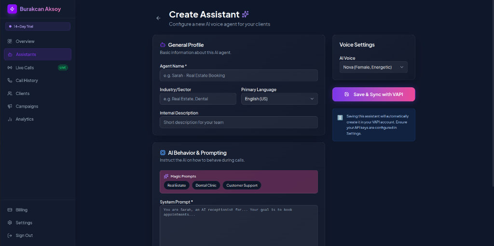
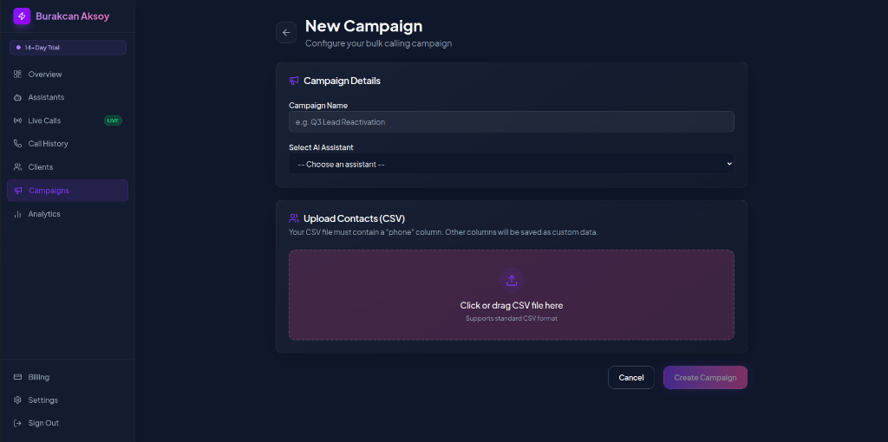
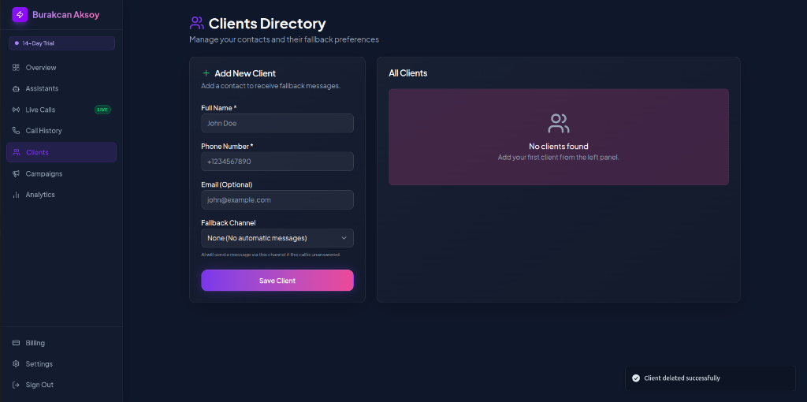
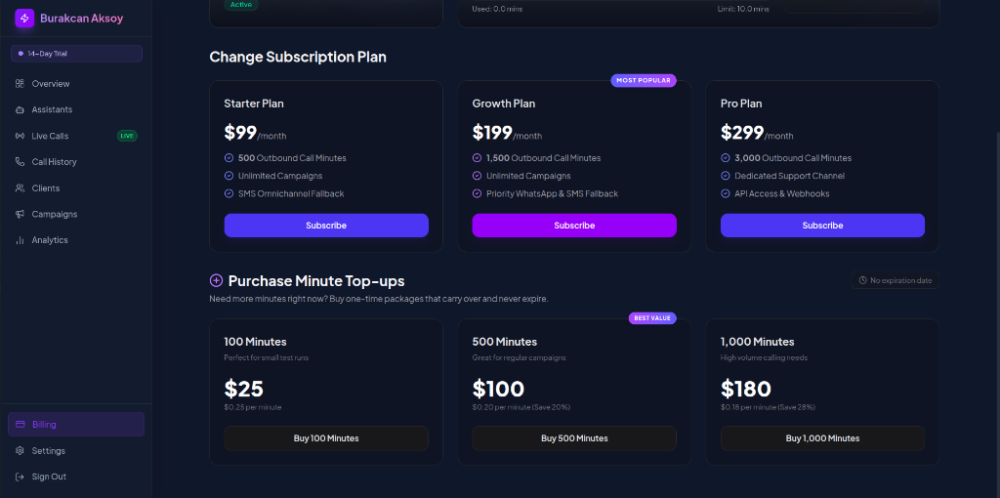
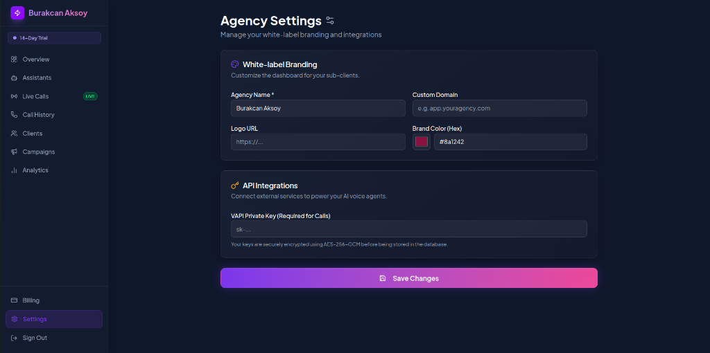
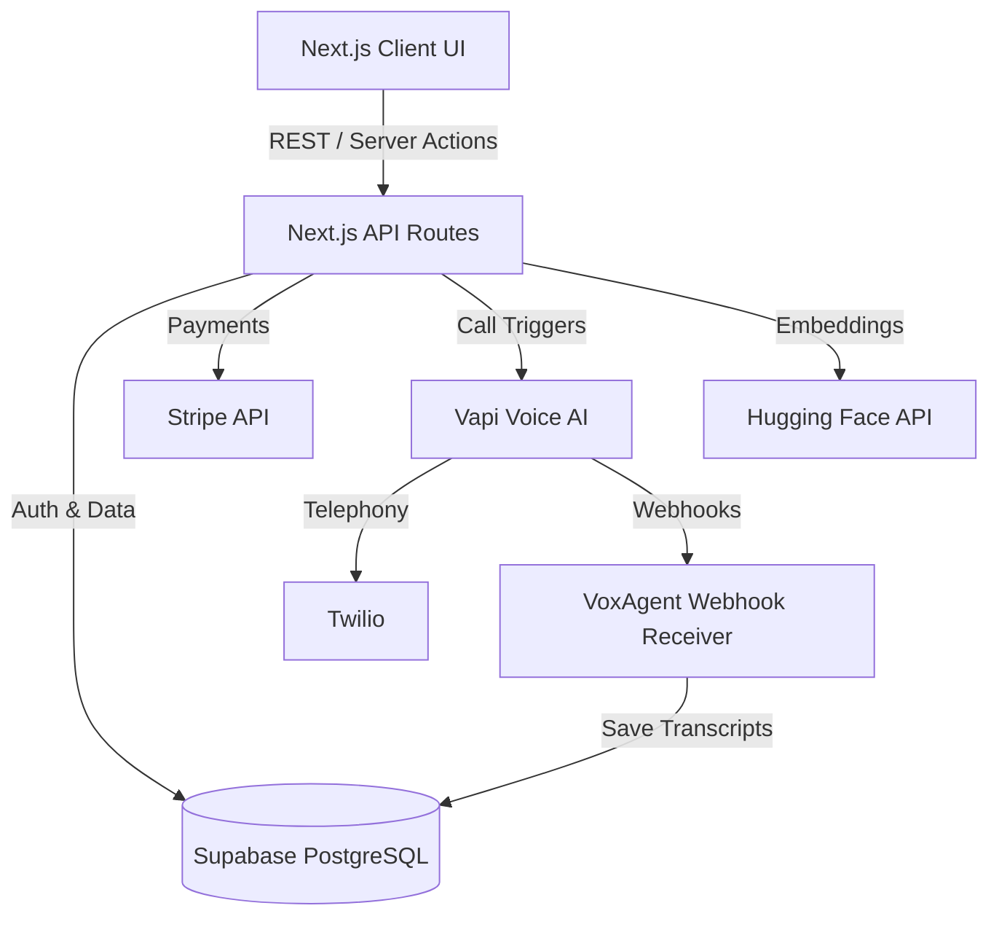

# VoxAgent

**The Ultimate White-label AI Voice Platform for Agencies and Enterprises.**

VoxAgent is a multi-tenant B2B SaaS platform that enables agencies to instantly deploy, manage, and resell AI-powered voice receptionists and outbound sales dialers under their own brand.

---

## Overview

VoxAgent bridges the gap between advanced conversational AI and everyday businesses. It provides a beautiful, fully functional dashboard where agencies can create AI voice assistants, upload knowledge bases (PDFs, text) for RAG (Retrieval-Augmented Generation), run outbound calling campaigns, and monitor call analytics. 

Built for scale and agency profitability, VoxAgent is designed for technical founders, marketing agencies, and enterprise sales teams who want to leverage Voice AI (via Vapi and Twilio) without building the complex orchestration, multi-tenancy, and billing infrastructure from scratch.

---

## Dashboard Showcase

Here is a preview of the VoxAgent white-label dashboard interface:

### 1. AI Voice Assistant Setup
Configure custom AI behavior, select professional voices, and synchronize seamlessly with Vapi.


### 2. Bulk Outbound Campaigns
Launch parallel calling campaigns by importing contacts via CSV with custom variables.


### 3. Clients & Contacts Directory
Manage your contacts and configure automatic SMS/WhatsApp fallback channels for unanswered calls.


### 4. Subscription & Minute Top-ups
Upgrade subscription plans and purchase minute packages that never expire.


### 5. Agency Settings & White-labeling
Customize the agency name, branding color, upload your logo, and configure custom domain routing and API keys.


---

## The Problem

- **Missed Opportunities:** Small to medium businesses miss up to 30% of inbound calls, leading to lost revenue and poor customer experience.
- **Expensive Scaling:** Scaling human customer support and outbound sales teams (BDRs/SDRs) is incredibly expensive, time-consuming, and prone to high turnover.
- **High Technical Barrier:** Existing Voice AI APIs (like Vapi, Retell, Bland) are built for developers. Agencies and business owners cannot use them directly without writing extensive code.
- **Lack of Reseller Tools:** Current SaaS solutions don't offer true white-labeling, making it hard for agencies to resell Voice AI services under their own domain and brand.

Without a product like VoxAgent, agencies are forced to either ignore the AI voice revolution or spend hundreds of thousands of dollars developing a proprietary orchestration platform.

---

## Our Solution

VoxAgent solves this by offering a completely "business-in-a-box" solution for Voice AI:
- **No-Code AI Configuration:** Users can define AI behavior, upload custom knowledge (RAG), and select voices without touching code.
- **True Multi-Tenancy:** Agencies can onboard their own clients, set up isolated environments, and manage usage limits.
- **Automated Workflows:** From uploading a CSV of leads to launching an outbound campaign of 1,000 parallel calls, everything is automated.
- **AI-Powered Quality:** By combining Vapi's ultra-low latency voice models with Hugging Face's semantic embeddings, the AI responds instantly, accurately, and with human-like intonation.

---

## Target Customers

| Persona | Why They Need It |
|---------|------------------|
| **Marketing & Lead Gen Agencies** | To upsell Voice AI services to existing clients, instantly calling new leads generated from ads. |
| **Sales Teams & BDRs** | To automate cold calling and appointment setting, allowing human reps to focus only on warm, qualified leads. |
| **Customer Support Centers** | To handle Tier 1 support, FAQ answering, and overflow routing 24/7. |
| **SaaS Founders** | To bootstrap a Voice AI startup without spending 6 months building billing, auth, and LLM integrations. |
| **Enterprises** | To deploy secure, internal HR or IT helpdesk voice assistants. |

---

## Business Value

- **Uncapped ROI for Agencies:** Buy AI minutes at wholesale API costs (cents per minute) and resell at a premium SaaS subscription rate.
- **Instant Deployment:** Launch a fully functional Voice AI SaaS in days, not months.
- **Extreme Time Savings:** Automate thousands of outbound calls simultaneously. What takes a human team a month takes VoxAgent minutes.
- **Operational Scalability:** Handle 1 call or 10,000 calls concurrently without hiring a single new employee.

---

## Core Features

| Feature | Description | Current Status | Future Improvements | Priority |
|---------|-------------|----------------|---------------------|----------|
| **White-label Dashboard** | Multi-tenant UI for agencies and their sub-clients. | ✅ Live | Custom domain routing, Custom CSS | High |
| **Outbound Campaigns** | Upload CSV leads and trigger bulk outbound calls. | ✅ Live | Smart retry logic, Voicemail drop | High |
| **Knowledge Base (RAG)** | Upload PDFs/TXTs to train the AI on specific business data. | ✅ Live | Web scraping, Notion integration | High |
| **Subscription Billing** | Stripe integration for SaaS tier management. | ✅ Live | Usage-based billing (per minute) | Medium |
| **Call Analytics** | View call logs, transcripts, and success metrics. | ✅ Live | Sentiment analysis, Call summaries | Medium |

---

## MVP Scope

**Included:**
- User Auth & Multi-tenant Architecture (Supabase)
- AI Voice Orchestration (Vapi API)
- Outbound Call Triggering
- Knowledge Base chunking and embedding (Hugging Face)
- UI/UX based on Glassmorphism and Framer Motion
- Stripe Checkout integration

**Not Included (Current Limitations):**
- Native mobile app.
- Direct inbound phone number purchasing within the UI (must be configured via Twilio/Vapi dashboard).
- Complex multi-agent transfer logic (Agent A transfers to Agent B).

**Assumptions:**
- Users will bring their own Vapi and OpenAI/Hugging Face API keys to configure their agents.

---

## Use Cases

### Use Case 1: The Real Estate Lead Qualifier
- **Problem:** A real estate agency receives hundreds of Facebook ad leads but cannot call them fast enough.
- **Workflow:** Leads are synced to VoxAgent. The AI immediately calls the lead, asks pre-qualification questions (budget, timeframe), and books an appointment on the agent's Calendly.
- **Expected Result:** 10x increase in lead connection rate; agents only talk to ready-to-buy clients.

### Use Case 2: 24/7 Dental Clinic Receptionist
- **Problem:** Dental clinic misses emergency calls after hours.
- **Workflow:** Clinic uploads their pricing PDF and FAQ to the Knowledge Base. Calls are routed to the VoxAgent assistant after 5 PM.
- **Expected Result:** Zero missed calls, emergency appointments booked automatically, patients receive immediate answers to pricing questions.

---

## Project Boundaries

- **Not a telephony provider:** VoxAgent relies on Twilio/Vapi for SIP trunks and numbers. It does not act as a telecom carrier.
- **Not a custom LLM:** The platform uses existing foundation models (GPT-4, Claude) via Vapi; it does not train models from scratch.
- **Scalability limits:** Bounded by the rate limits of the underlying APIs (Vapi concurrency limits, Supabase database connections). 

---

## Technical Architecture

The platform utilizes a modern serverless edge architecture.



- **Frontend:** Next.js 16 (App Router), Tailwind CSS v4, Framer Motion, Radix UI.
- **Backend:** Next.js API Routes, Server Actions.
- **Database:** Supabase (PostgreSQL) with Row Level Security (RLS).
- **AI Services:** Vapi (Voice Orchestration), Hugging Face (Embeddings).
- **External APIs:** Stripe, Twilio.

---

## Tech Stack

| Technology | Purpose | Reason for choosing | Alternative considered |
|------------|---------|---------------------|------------------------|
| **Next.js (App Router)** | Fullstack Framework | Best SEO, React Server Components, fast API routes. | Vite/React + Node.js |
| **Supabase** | DB, Auth, Storage | Realtime Postgres, instant APIs, built-in Auth. | Firebase, PlanetScale |
| **Vapi** | Voice AI Engine | Lowest latency conversational AI on the market. | Retell AI, Bland AI |
| **Tailwind CSS v4** | Styling | Rapid UI development, utility-first. | Styled Components |
| **Framer Motion** | Animations | Smooth, physics-based UI transitions. | CSS Keyframes |
| **Hugging Face** | Embeddings (RAG) | Cost-effective open-source embedding models. | OpenAI Embeddings |

---

## Database

Powered by **Supabase PostgreSQL**.

- **Tables:** `users`, `agencies`, `assistants`, `campaigns`, `knowledge_bases`, `calls`, `subscriptions`.
- **Security:** Strict Row Level Security (RLS) ensures users can only query data belonging to their specific `agency_id`.
- **Storage:** Supabase Storage used for storing uploaded PDFs and CSVs.
- **Vector Search:** `pgvector` extension utilized for semantic search across Knowledge Base chunks.

---

## Authentication

- **Provider:** Supabase Auth.
- **Flow:** JWT-based session management utilizing `@supabase/ssr` for seamless server-side and client-side auth state.
- **Roles:** Handled at the database level. Every user belongs to an `agency`.

---

## Security

- **Vapi Key Encryption:** Agency API keys are AES-256 encrypted at rest before storing in the database using the `ENCRYPTION_SECRET`.
- **Row Level Security (RLS):** Prevents cross-tenant data leakage at the PostgreSQL level.
- **Environment Variables:** Strictly separated between client (`NEXT_PUBLIC_`) and server environments.
- **Webhook Verification:** Incoming webhooks from Vapi and Stripe are verified cryptographically.

---

## API Documentation

### `POST /api/campaigns/launch`
- **Description:** Triggers a bulk outbound calling campaign.
- **Auth Required:** Yes (Session JWT)
- **Request:** `{ "campaignId": "uuid" }`
- **Response:** `{ "success": true, "callsTriggered": 150 }`

### `POST /api/knowledge/upload`
- **Description:** Uploads a document, chunks it, creates embeddings, and stores in Vector DB.
- **Auth Required:** Yes
- **Request:** `FormData` containing file and `assistantId`.
- **Response:** `{ "success": true, "chunksProcessed": 45 }`

### `POST /api/webhooks/vapi/[agencyId]`
- **Description:** Receives end-of-call reports from Vapi.
- **Auth Required:** No (Uses cryptographic signature)
- **Request:** Vapi standard webhook payload.
- **Response:** 200 OK

---

## Environment Variables

| Variable | Description | Required | Example |
|----------|-------------|----------|---------|
| `NEXT_PUBLIC_SUPABASE_URL` | Supabase project URL | Yes | `https://xyz.supabase.co` |
| `NEXT_PUBLIC_SUPABASE_ANON_KEY` | Supabase Anon Key | Yes | `eyJhbG...` |
| `SUPABASE_SERVICE_ROLE_KEY` | Supabase admin bypass key | Yes | `eyJhbG...` |
| `STRIPE_SECRET_KEY` | Stripe backend key | Yes | `sk_test_...` |
| `ENCRYPTION_SECRET` | 32-char string for AES-256 | Yes | `my-super-secret-32-char-key-here!`|
| `VAPI_PRIVATE_KEY` | Global Vapi fallback key | No | `421d75ef...` |
| `HUGGINGFACE_API_KEY` | API key for embeddings | Yes | `hf_XdB...` |

---

## Installation & Running Locally

1. **Clone the repository:**
   ```bash
   git clone https://github.com/your-username/voxagent.git
   cd voxagent
   ```
2. **Install dependencies:**
   ```bash
   npm install
   ```
3. **Configure Environment:**
   Copy `.env.example` to `.env.local` and fill in your Supabase, Stripe, and Hugging Face keys.
4. **Run the Development Server:**
   ```bash
   npm run dev
   ```
5. **Access the App:** Navigate to `http://localhost:3000`

---

## Deployment

VoxAgent is optimized for deployment on **Vercel**.
1. Connect your GitHub repository to Vercel.
2. Add the environment variables in the Vercel dashboard.
3. Deploy.

*Note: Because we use Next.js App Router and Server Actions, Vercel edge caching and serverless functions handle scale automatically.*

---

## Testing Strategy

- **Linting & Type Checking:** Enforced strictly via `eslint` and `tsc` during the CI/CD pipeline.
- **Manual QA:** End-to-end testing of the call triggering flow using dummy Twilio numbers.
- **Future Improvements:** Implementation of Playwright for automated E2E testing of the agency dashboard workflows.

---

## Known Limitations

- **Concurrency Handling:** Currently relies on Vapi's internal queueing. If an agency triggers 10,000 calls at once, it may hit Vapi rate limits unless specifically negotiated with their enterprise tier.
- **Knowledge Base File Types:** Currently limited to PDF, TXT, and CSV. No support for direct URL scraping yet.

---

## Roadmap

- **Short Term (Q3):** Usage-based billing (charge clients per AI minute via Stripe Metered Billing), Dashboard Analytics overhaul.
- **Mid Term (Q4):** Direct phone number purchasing via Twilio integration inside the UI, Calendar integrations (Google Calendar, Outlook) for appointment setting.
- **Long Term (Next Year):** AI Agent transfer (transferring a call from AI to a Human Agent in a browser-based softphone), Custom LLM fine-tuning.

---

## Competitor Comparison

| Feature | VoxAgent | Bland AI | Custom Agency Build |
|---------|----------|----------|---------------------|
| **Target Audience** | SaaS Resellers & Agencies | Developers & Enterprises | The Agency Itself |
| **White-labeling** | ✅ True Multi-tenant | ❌ API Only | ❌ Internal Use Only |
| **Speed to Market**| Instant | Requires custom dev | Months of coding |
| **Cost** | Fixed SaaS + API Costs | High Per-Minute Cost | High Capital Expenditure |
| **Unique Advantage**| Ready-to-sell business | Highly customizable | Total ownership |

---

## Why Customers Should Buy This Product

If you are an agency owner, building a secure, scalable platform with Stripe billing, Supabase authentication, and Vapi orchestration will cost you $30,000+ in developer salaries and 4 months of time. 

**VoxAgent gives you the entire infrastructure today.** You can focus on marketing, selling to local businesses, and generating revenue immediately. You aren't just buying software; you are buying a scalable business asset.

---

## Contributing

Contributions are welcome! Please create an issue to discuss the proposed changes before submitting a Pull Request. Ensure your code passes `npm run lint` and `npm run build`.

---

## License

Copyright © 2026. All rights reserved. (Update with appropriate Open Source or Proprietary license depending on distribution strategy).

---

## Contact

For support, investment inquiries, or enterprise licensing, please reach out via GitHub Issues or contact the maintainers directly.

---

*Generated by AI based on project analysis. Last updated: July 2026.*
