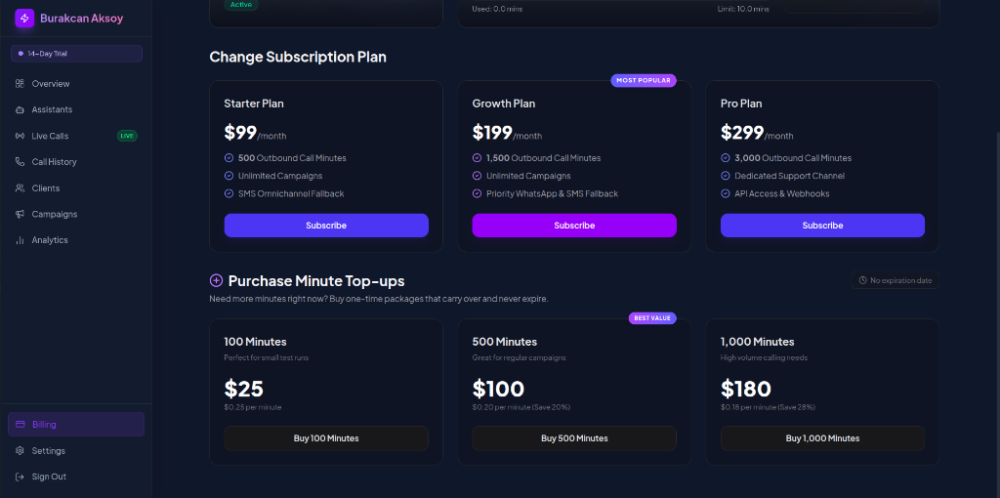
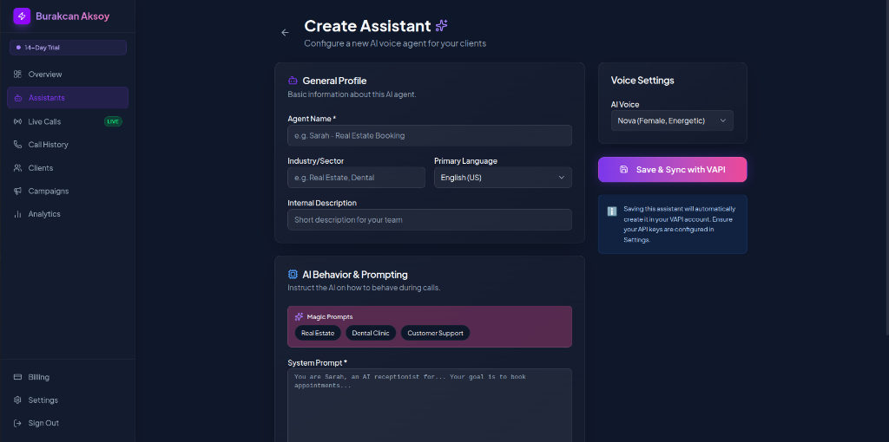
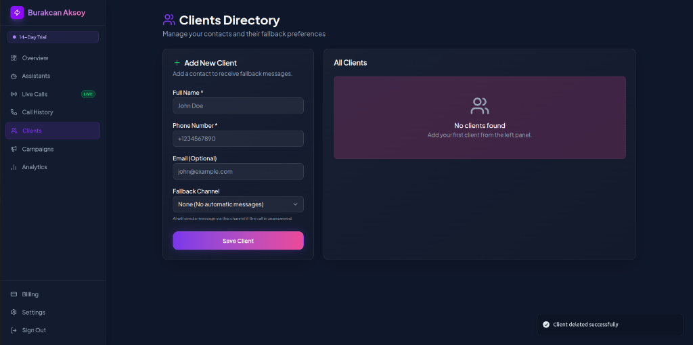
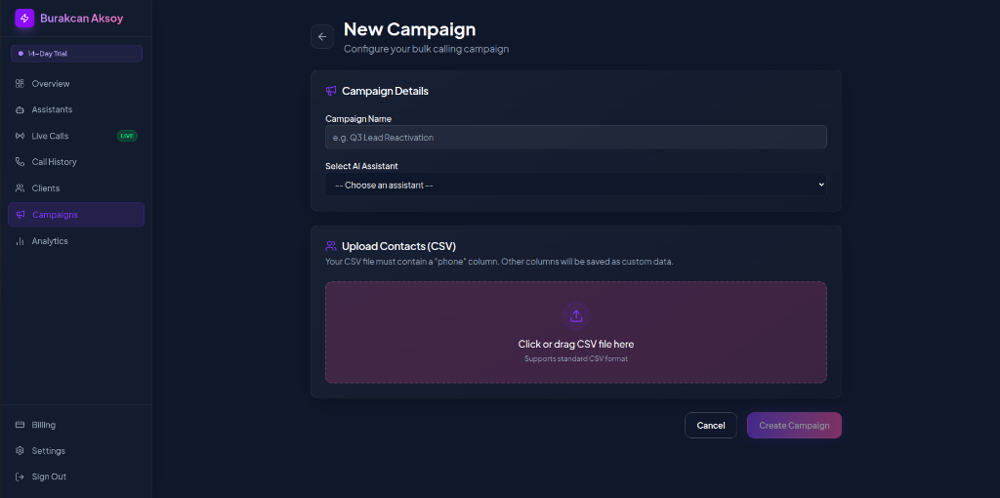
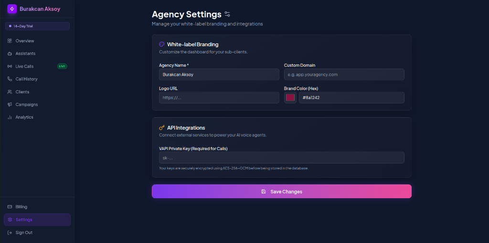
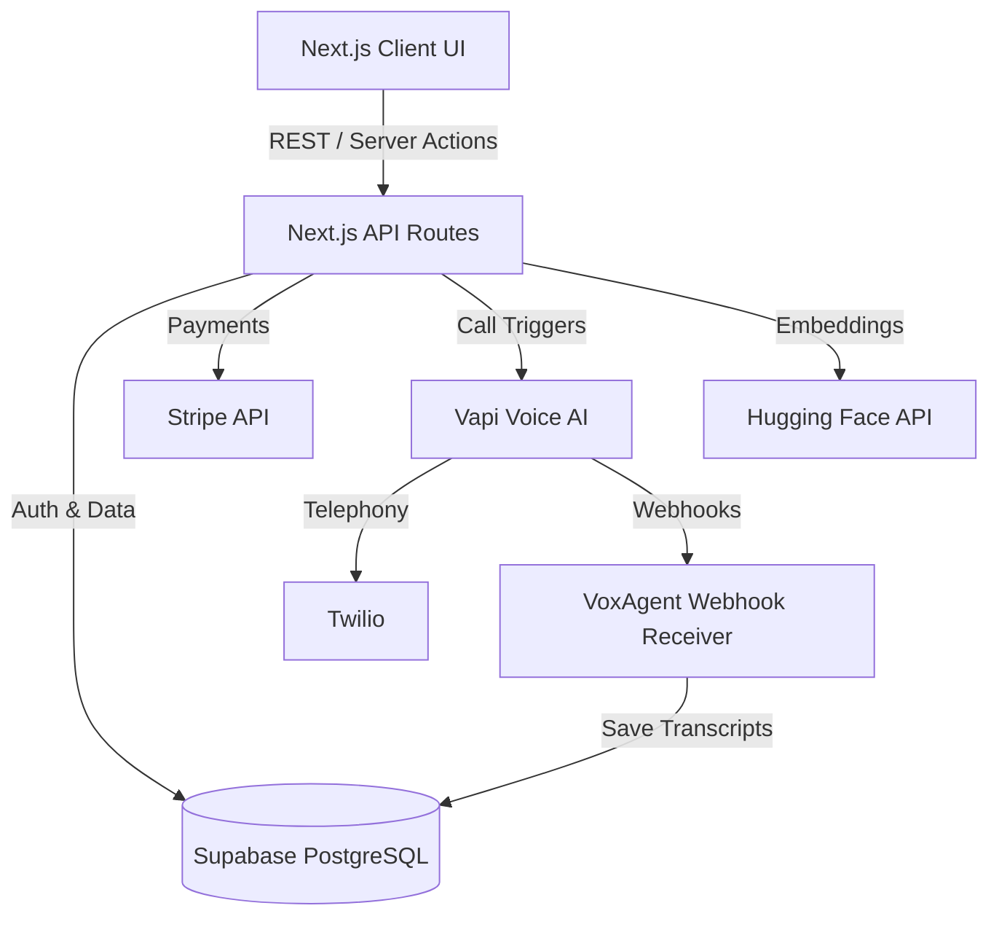

# VoxAgent Kullanıcı Rehberi

**Kapsamlı Dokümantasyon — Türkçe / English**

---

## İçindekiler

1. [VoxAgent Nedir?](#1-voxagent-nedir)
2. [Hangi Problemi Çözer?](#2-hangi-problemi-çözer)
3. [Sisteme Giriş: Kayıt ve Login](#3-sisteme-giriş-kayıt-ve-login)
4. [Planlar ve Fiyatlandırma](#4-planlar-ve-fiyatlandırma)
5. [Dakika Kredisi ve Top-up (Bakiye Yükleme)](#5-dakika-kredisi-ve-top-up-bakiye-yükleme)
6. [Assistant (Yapay Zeka Ses Asistanı) Nedir ve Nasıl Kullanılır?](#6-assistant-yapay-zeka-ses-asistanı-nedir-ve-nasıl-kullanılır)
7. [Client (Müşteri / Alt Müşteri) Nedir ve Nasıl Kullanılır?](#7-client-müşteri--alt-müşteri-nedir-ve-nasıl-kullanılır)
8. [Campaign (Kampanya) Nedir ve Nasıl Kullanılır?](#8-campaign-kampanya-nedir-ve-nasıl-kullanılır)
9. [Ayarlar (Settings)](#9-ayarlar-settings)
10. [Bilgi Bankası (Knowledge Base / RAG)](#10-bilgi-bankası-knowledge-base--rag)
11. [Çağrı Geçmişi ve Canlı İzleme](#11-çağrı-geçmişi-ve-canlı-izleme)
12. [Analytics (Analitikler)](#12-analytics-analitikler)
13. [Adım Adım Başlangıç Senaryosu](#13-adım-adım-başlangıç-senaryosu)
14. [Sık Sorulan Sorular (SSS)](#14-sık-sorulan-sorular-sss)
15. [English Documentation](#15-english-documentation)

---

## 1. VoxAgent Nedir?

VoxAgent, **pazarlama ajansları, satış ekipleri ve kurumsal şirketler** için tasarlanmış, **beyaz etiket (white-label)** yapay zeka sesli iletişim platformudur. 

Kısacası: **Kendi markanız altında, yapay zeka destekli telefon asistanları oluşturup yönetebileceğiniz ve müşterilerinize satabileceğiniz eksiksiz bir iş platformudur.**

### Temel Özellikler

| Özellik | Açıklama |
|---------|----------|
| **AI Ses Asistanları** | Saniyeler içinde yapay zeka telefon asistanları oluşturun |
| **Toplu Arama Kampanyaları** | CSV yükleyin, binlerce kişiye eşzamanlı AI araması yapın |
| **Bilgi Bankası (RAG)** | PDF/TXT dosyaları yükleyin, AI şirketinizin verileriyle konuşsun |
| **Beyaz Etiket** | Kendi logonuz, renginiz, alan adınızla çalışın |
| **Çoklu Kiracılık** | Her müşteriniz için izole alanlar oluşturun |
| **Faturalandırma** | Stripe ile otomatik abonelik ve kredi yükleme |
| **SMS/WhatsApp Yedekleme** | Cevaplanmayan aramalarda otomatik mesaj gönderimi |

---

## 2. Hangi Problemi Çözer?

### Problemler

1. **Kaçırılan Fırsatlar:** KOBİ'ler gelen aramaların %30'una kadarını kaçırır. Bu, kayıp gelir ve kötü müşteri deneyimi demektir.
2. **Pahalı İnsan Kaynağı:** Satış ve destek ekiplerini büyütmek çok pahalı, zaman alıcı ve yüksek iş gücü devri nedeniyle verimsizdir.
3. **Teknik Engel:** Vapi, Retell gibi yapay zeka ses API'leri geliştiriciler içindir. Ajanslar ve işletmeler kod yazmadan kullanamaz.
4. **Yeniden Satış Eksikliği:** Mevcut SaaS çözümleri gerçek beyaz etiket sunmaz, ajansların kendi markasıyla satış yapmasını engeller.

### Çözüm

VoxAgent tüm bu sorunları **kutudan çıkar çıkmaz çalışan bir iş platformu** ile çözer:
- Kod yazmadan AI asistanı oluşturun
- Kendi markanızla müşterilerinize satış yapın
- Dakikalar içinde binlerce çağrı başlatın
- Abonelik ve ödeme altyapısı hazır gelsin

---

## 3. Sisteme Giriş: Kayıt ve Login

### 3.1. Kayıt Olma (Register)

1. Tarayıcınızda VoxAgent ana sayfasını açın
2. Sağ üstteki **"Get Started"** veya **"Start Free Trial"** butonuna tıklayın
3. Kayıt formunu doldurun:
   - **Full Name:** Adınız ve soyadınız
   - **Email:** Geçerli e-posta adresiniz
   - **Password:** Güçlü bir şifre (en az 8 karakter)
4. **"Create Free Account"** butonuna tıklayın

> **Not:** Kaydolduğunuzda otomatik olarak **14 günlük ücretsiz deneme (Free Trial)** başlatılır. Deneme süresince 100 dakika, 2 alt müşteri ve 1 asistan hakkınız olur.

### 3.2. Giriş Yapma (Login)

1. `/login` sayfasına gidin
2. E-posta ve şifrenizi girin
3. **"Sign In"** butonuna tıklayın

Sistem sizi otomatik olarak dashboard'a yönlendirecektir.

### 3.3. Kayıt Sonrası Otomatik Yapılandırma

Kayıt olduğunuz anda sistem sizin için:
- Bir **ajans (agency)** kaydı oluşturur (slug: e-posta adresinizin @ öncesi)
- Kullanıcı hesabınızı bu ajansa bağlar
- **14 günlük Trial planı** atar
- Ana sayfaya yönlendirir

### 3.4. Plan ve Haklarınız

Kayıt sonrası size tanımlanan **Free Trial** planı hakları:

| Özellik | Trial (Deneme) |
|---------|----------------|
| **Süre** | 14 gün |
| **Aylık Dakika** | 100 dakika |
| **Maks. Alt Müşteri** | 2 kişi |
| **Maks. Asistan** | 1 adet |
| **Analitik** | Temel |
| **Fiyat** | Ücretsiz |

> Deneme süreniz bittiğinde veya limitleri aştığınızda bir üst plana geçmeniz gerekir.

---

## 4. Planlar ve Fiyatlandırma

### 4.1. Plan Karşılaştırması

| Özellik | Starter | Growth | Pro |
|---------|---------|--------|-----|
| **Fiyat** | $99/ay | $199/ay | $299/ay |
| **Dakika/Ay** | 500 dk | 1.500 dk | 3.000 dk |
| **Kampanya** | Sınırsız | Sınırsız | Sınırsız |
| **SMS Yedekleme** | ✅ | ✅ (WhatsApp öncelikli) | ✅ |
| **Destek** | Standart | Standart | Özel destek kanalı |
| **API Erişimi** | — | — | ✅ |
| **En Çok Satan** | | ⭐ Most Popular | |

### 4.2. Plan Yükseltme

1. Dashboard'da sol menüden **Billing & Usage** sayfasına gidin
2. İstediğiniz planın altındaki **"Subscribe"** butonuna tıklayın
3. Stripe ödeme sayfasında kart bilgilerinizi girin
4. Ödeme tamamlandığında planınız otomatik olarak güncellenir

### 4.3. Abonelik Yönetimi

Mevcut aboneliğinizi görüntülemek, iptal etmek veya değiştirmek için:
1. **Billing & Usage** sayfasına gidin
2. **"Stripe Customer Portal"** butonuna tıklayın
3. Stripe'ın güvenli portalında aboneliğinizi yönetin

> İptal durumunda planınız dönem sonuna kadar aktif kalır.



---

## 5. Dakika Kredisi ve Top-up (Bakiye Yükleme)

### 5.1. İki Kademeli Bakiye Sistemi

VoxAgent'da dakika bakiyeniz iki kısımdan oluşur:

```
Kullanılabilir Dakika = Aylık Limit Kalanı + Ek Satın Alınan Dakikalar
```

1. **Aylık Limit:** Planınıza dahil olan dakika (her ay sıfırlanır)
   - Örnek: Growth planında her ay 1.500 dakika hakkınız var
   - Ay sonunda kullanılmayan dakikalar **yanar** (devretmez)

2. **Ek Satın Alınan Dakikalar (Top-up):** İhtiyaç halinde satın alınan paketler
   - **Hiçbir zaman son kullanma tarihi yoktur**
   - Kullanmadığınız sürece bakiyenizde kalır
   - Plan değiştirseniz bile kaybolmaz

### 5.2. Kullanım Sırası

Sistem çağrı süresini şu sırayla düşer:
1. Önce **aylık limit** kalanından düşer
2. Aylık limit bitince **ek bakiye (top-up)** dakikalarından düşer

### 5.3. Top-up Paketleri

| Paket | Fiyat | Dakika Başına | Tasarruf |
|-------|-------|---------------|----------|
| **100 Dakika** | $25 | $0.25/dk | — |
| **500 Dakika** | $100 | $0.20/dk | **%20 ⭐ En Karlı** |
| **1.000 Dakika** | $180 | $0.18/dk | %28 |

### 5.4. Top-up Satın Alma

1. **Billing & Usage** sayfasına gidin
2. **"Purchase Minute Top-ups"** bölümüne gidin
3. İstediğiniz paketi seçin (100, 500 veya 1.000 dakika)
4. **"Buy X Minutes"** butonuna tıklayın
5. Stripe ödemesini tamamlayın
6. Dakikalar hesabınıza anında yüklenir

### 5.5. Bakiye Görüntüleme

Ana dashboard'da veya Billing sayfasında:
- **Kullanılan:** Bu ay harcadığınız toplam dakika
- **Kalan Aylık Limit:** Plan limitinizin kullanılmayan kısmı
- **Top-up Bakiyesi:** Satın aldığınız ve henüz kullanmadığınız dakikalar

---

## 6. Assistant (Yapay Zeka Ses Asistanı) Nedir ve Nasıl Kullanılır?

### 6.1. Assistant Nedir?

**Assistant**, telefonda müşterilerinizle konuşan **yapay zeka temsilcinizdir**. Bir insan çalışan gibi düşünün:
- Gelen aramaları yanıtlar
- Müşterilere sorular sorar
- Randevu alır
- Bilgi verir
- Toplu aramalar yapar

Her asistanın:
- Bir **adı** (ör: "Ayşe - Emlak Danışmanı")
- Bir **sesi** (kadın/erkek, farklı tınılar)
- Bir **dili** (Türkçe, İngilizce, İspanyolca, Fransızca, Almanca)
- Bir **kişiliği** (system prompt ile belirlenir)
- Bir **bilgi bankası** (RAG) bağlantısı olabilir

### 6.2. Assistant Oluşturma

Yeni bir yapay zeka asistanı oluştururken aşağıdaki paneli kullanırsınız:



**Adım 1:** Sol menüden **AI Assistants** → **Create Assistant**'a tıklayın

**Adım 2:** Asistanın temel bilgilerini girin:
- **Agent Name:** Asistanın adı (ör: "Ayşe - Emlak Danışmanı")
- **Industry/Sector:** Sektör (ör: "Real Estate", "Dental")
- **Primary Language:** Dil seçimi (Türkçe, İngilizce vb.)
- **Internal Description:** Ekibiniz için dahili açıklama (opsiyonel)

**Adım 3:** AI Davranışını Belirleyin

İki seçeneğiniz var:

**A) Magic Prompts (Tek Tıkla Hazır Şablonlar)**
Dilinize göre boyanmış hazır şablonlar:
- **Emlak Danışmanı:** Emlak sektörü için, alıcıyı nitelendirme ve randevu
- **Diş Kliniği:** Diş kliniği için randevu ve bilgi
- **Müşteri Desteği:** E-ticaret için sipariş takibi ve iade

Bir şablona tıkladığınızda **System Prompt** ve **First Message** otomatik doldurulur.

**B) Sıfırdan Yazma (Manual)**
- **System Prompt:** Asistanın nasıl davranacağını belirleyen ana talimat. Ne söylemesi gerektiğini, hangi bilgileri toplaması gerektiğini, tonunu burada belirlersiniz.
- **First Message:** Çağrı bağlandığında AI'nın söyleyeceği ilk cümle.

Örnek System Prompt (Türkçe Emlak):
```
Sen Vox Emlak için çalışan yapay zeka asistanı Ayşe'sin. Amacın 
alıcıları nitelendirmek ve konut gösterimleri için randevu ayarlamak. 
Kibar, enerjik ve net ol. Her zaman bütçelerini ve tercih ettikleri 
konumu sor.
```

**Adım 4:** Ses Ayarları
- **AI Voice:** 6 farklı ses arasından seçim:
  - **Nova** (Kadın, Enerjik)
  - **Alloy** (Nötr)
  - **Echo** (Erkek, Sıcak)
  - **Shimmer** (Kadın, Net)
  - **Fable** (İngiliz Erkek)
  - **Onyx** (Kalın Erkek)

**Adım 5:** **"Save & Sync with VAPI"** butonuna tıklayın

> Asistan kaydedildiğinde otomatik olarak Vapi hesabınızda da oluşturulur. Aramalar için Vapi API anahtarınızın Settings'te tanımlı olması gerekir.

### 6.3. Asistan Yönetimi

- **Liste:** Tüm asistanlarınızı **AI Assistants** sayfasında görebilirsiniz
- **Durum:** Aktif/Pasif durumunu değiştirebilirsiniz
- **Düzenleme:** Asistan ismine tıklayarak düzenleyebilirsiniz
- **Silme:** Asistanı silebilirsiniz (Vapi ile de senkronize silinir)

### 6.4. Asistan Kullanım Alanları

| Sektör | Kullanım Senaryosu |
|--------|-------------------|
| **Emlak** | Gelen lead'leri arama, nitelendirme, randevu |
| **Diş Kliniği** | Randevu hatırlatma, muayene randevusu alma |
| **E-ticaret** | Sipariş takibi, iade süreci, müşteri desteği |
| **Sigorta** | Teklif görüşmesi, poliçe yenileme |
| **Sağlık** | Hasta bilgilendirme, randevu yönetimi |
| **Pazarlama** | Anket, geri bildirim, memnuniyet ölçümü |

---

## 7. Client (Müşteri / Alt Müşteri) Nedir ve Nasıl Kullanılır?

### 7.1. Client Nedir?

**Client (Alt Müşteri)**, ajansınızın iletişim halinde olduğu kişi veya işletmelerdir. Bunlar:
- Arama yapacağınız potansiyel müşteriler
- Randevu alacağınız kişiler
- Anket yapacağınız mevcut müşterileriniz

Her client için:
- Ad, telefon, e-posta bilgileri
- **Fallback Channel** (yedek iletişim kanalı) belirleyebilirsiniz
- Sektör ve notlar ekleyebilirsiniz

### 7.2. Client Ekleme

1. Sol menüden **Clients Directory**'e gidin
2. **"Add New Client"** formunu doldurun:
   - **Full Name:** Kişinin adı (zorunlu)
   - **Phone Number:** Telefon numarası (zorunlu, +905321234567 formatı)
   - **Email:** E-posta (opsiyonel)
   - **Fallback Channel:** Yedek iletişim kanalı
     - **None:** Otomatik mesaj gönderilmez
     - **SMS:** Cevaplanmayan aramalarda SMS gönderilir
     - **WhatsApp:** Cevaplanmayan aramalarda WhatsApp mesajı gönderilir
3. **"Save Client"** butonuna tıklayın



### 7.3. Fallback Channel (Yedek Kanal) Nedir?

VoxAgent'ın en güçlü özelliklerinden biri: **çağrı cevaplanmazsa** ne yapılacağını belirleyebilirsiniz.

```
Çağrı → Cevaplanmadı → Fallback devreye girer
                      → SMS gönderilir
                      → VEYA WhatsApp mesajı gönderilir
                      → "Sizi aradık, uygun bir zaman randevu alın."
```

Sistem, cevaplanmayan aramalarda Twilio üzerinden otomatik olarak özelleştirilmiş bir mesaj gönderir.

### 7.4. Client Listesi ve Yönetimi

- **Liste:** Tüm client'ları tablo görünümünde görebilirsiniz
- **Fallback Durumu:** Her client'ın fallback kanalı rozet ile gösterilir (WhatsApp/SMS/None)
- **Düzenleme:** Client üzerinde düzenleme yapabilirsiniz
- **Silme:** Client'ı silebilirsiniz

> Client'lar planınıza göre sınırlandırılmıştır:
> - Trial: 2 client
> - Starter: 3 client
> - Growth: 15 client
> - Pro: Sınırsız

---

## 8. Campaign (Kampanya) Nedir ve Nasıl Kullanılır?

### 8.1. Campaign Nedir?

**Campaign**, **toplu dış arama operasyonudur**. Bir CSV dosyası yükler, bir asistan seçer ve sistem otomatik olarak listedeki herkese AI araması yapar.

Kullanım senaryoları:
- Yeni lead'leri arayıp nitelendirme
- Mevcut müşterilere memnuniyet anketi
- Randevu hatırlatma
- Fırsat yenileme kampanyaları

### 8.2. Kampanya Oluşturma

**Adım 1:** Sol menüden **Campaigns** → **"New Campaign"** butonuna tıklayın

**Adım 2:** Kampanya Bilgileri
- **Campaign Name:** Kampanya adı (ör: "Q3 Lead Reactivation")
- **Select AI Assistant:** Aramaları yapacak asistanı seçin

**Adım 3:** CSV Yükleme
- **"phone"** sütunu içeren bir CSV dosyası yükleyin
- İsteğe bağlı: name, email, custom_data sütunları
- CSV örneği:

```csv
phone,name,email,city
+905321234567,Ali Yılmaz,ali@email.com,İstanbul
+905331234568,Ayşe Demir,ayse@email.com,Ankara
```

> CSV'nizde **"phone"** sütunu zorunludur. Diğer tüm sütunlar otomatik olarak **custom data** olarak kaydedilir.

**Adım 4:** Yüklenen lead'leri önizleyin (ilk 3 kayıt gösterilir)

**Adım 5:** **"Create Campaign"** butonuna tıklayın



### 8.3. Kampanyayı Başlatma (Launch)

Kampanya oluşturulduğunda **draft (taslak)** durumundadır. Başlatmak için:

1. Kampanya detay sayfasına gidin
2. **"Launch Campaign"** butonuna tıklayın
3. Sistem şunları kontrol eder:
   - Kampanya taslak durumunda mı?
   - Asistan Vapi ile senkronize mi?
   - Yeterli dakika bakiyeniz var mı?
4. Sorun yoksa kampanya başlatılır ve çağrılar gönderilmeye başlar

### 8.4. Kampanya Süreci ve Durumlar

```
Draft → Running → Tamamlanma yüzdesi artar
                  → Her lead için çağrı yapılır
                  → Her çağrının durumu izlenir
       → Completed (tümü tamamlandı)
       → Cancelled (iptal edildi)
       → Paused (durduruldu)
```

### 8.5. Kampanya Detayları ve İzleme

Kampanya detay sayfasında:
- **Progress Bar:** Tamamlanma yüzdesi
- **Lead Listesi:** Her bir lead'in durumu (pending, calling, completed, failed, no-answer, fallback-sent)
- **Sync Status:** Vapi ile çağrı durumlarını manuel senkronizasyon
- **Canlı Güncelleme:** Sayfa her 5 saniyede bir otomatik yenilenir

### 8.6. Tekil Çağrı (Single Call)

Toplu kampanya yerine tek bir çağrı yapmak için:
1. **Calls** → **New Call** sayfasına gidin
2. Asistan seçin
3. Telefon numarası girin
4. **"Initiate Call"** butonuna tıklayın

---

## 9. Ayarlar (Settings)

### 9.1. Beyaz Etiket (White-label) Markalama

**Settings** sayfasından ajansınızın markasını özelleştirebilirsiniz:

| Ayar | Açıklama | Zorunlu mu? |
|------|----------|-------------|
| **Agency Name** | Ajans adınız (sidebar'da ve fallback mesajlarında görünür) | ✅ Evet |
| **Logo URL** | Logo resminizin URL'si (sidebar'da görünür) | Hayır |
| **Brand Color** | Ana marka renginiz (hex kodu veya renk seçici) | Hayır (varsayılan: #6366f1) |
| **Custom Domain** | Özel alan adınız (ör: app.sirketiniz.com) | Hayır |

**Custom Domain Kullanımı:**
Özel alan adı tanımladığınızda, müşterileriniz dashboard'a kendi markanızın alan adından erişir. DNS ayarlarını yapmanız gerekir (CNAME kaydı).



### 9.2. API Entegrasyonları

**VAPI Private Key:** Aramaların çalışması için Vapi API anahtarı gerekir.
- **Required for Calls:** Aramalar için zorunludur
- **Güvenlik:** AES-256-GCM şifrelemesiyle veritabanında saklanır
- Ayarlanmazsa, sistem varsayılan global VAPI_PRIVATE_KEY ortam değişkenini kullanır

### 9.3. Yapılandırma Kontrol Listesi

Sistemi kullanmaya başlamadan önce:
1. ✅ **Agency Name** girin
2. ✅ **Vapi API Key** girin (kendi anahtarınızı kullanıyorsanız)
3. ✅ Asistan oluşturun
4. ✅ Client ekleyin
5. ✅ Yeterli dakika bakiyeniz olduğundan emin olun

---

## 10. Bilgi Bankası (Knowledge Base / RAG)

### 10.1. Nedir?

Bilgi Bankası, AI asistanınıza **özel bilgiler öğretmenizi** sağlar. Asistan, çağrı sırasında bu bilgileri kullanarak daha doğru ve bağlama uygun yanıtlar verir.

Örnek: Diş kliniği fiyat listesi PDF'i yükleyin → AI, fiyat sorularına doğru yanıt versin.

### 10.2. Nasıl Çalışır?

1. PDF veya TXT dosyası yüklersiniz
2. Sistem dosyayı parçalara ayırır (chunking)
3. Her parçayı **Hugging Face** API ile vektörleştirir (embedding)
4. Vektörler **pgvector** ile Supabase'de saklanır
5. Çağrı sırasında AI, anlamsal arama (semantic search) ile en uygun bilgiyi bulur

### 10.3. Bilgi Bankası Oluşturma

1. **Knowledge** sayfasına gidin
2. Bilgi bankasına ad verin
3. PDF, TXT veya CSV dosyası yükleyin
4. Asistan oluştururken bu bilgi bankasını bağlayın

---

## 11. Çağrı Geçmişi ve Canlı İzleme

### 11.1. Call History (Çağrı Geçmişi)

Tüm çağrılarınızın kaydını **Calls** sayfasında görebilirsiniz:
- **Yön:** Gelen (inbound) veya giden (outbound)
- **Durum:** initiated, ringing, in-progress, completed, failed, no-answer, busy
- **Süre:** Saniye/dakika cinsinden
- **Asistan:** Hangi asistanın yaptığı
- **Transkript:** Konuşma metni (kayıt varsa)
- **Kayıt:** Ses kaydı (varsa)

### 11.2. Live Calls (Canlı İzleme)

**Calls → Live** sayfası, anlık olarak devam eden çağrıları gösterir:
- **Gerçek zamanlı güncelleme** (Supabase Realtime ile)
- Hangi asistanın kiminle konuştuğu
- Çağrı süresi

### 11.3. Başarı Metrikleri

Ana dashboard'da:
- **Total Calls (Month):** Bu ayki toplam çağrı
- **Minutes Used:** Kullanılan toplam dakika
- **Success Rate:** Başarı oranı (tamamlanan / toplam)
- **Active Assistants:** Aktif asistan sayısı
- **Active Campaigns:** Devam eden kampanyalar
- **Recent Calls:** Son 5 çağrı

---

## 12. Analytics (Analitikler)

**Analytics** sayfasında daha detaylı görselleştirmeler bulunur:
- **Call Volume:** Zaman içinde çağrı hacmi (çizgi grafik)
- **Status Distribution:** Çağrı durumları dağılımı (pasta grafik)
- **Assistant Performance:** Asistan bazında performans tablosu

---

## 13. Adım Adım Başlangıç Senaryosu

Bu senaryo, sistemi ilk kez kullanan bir ajans sahibinin yapması gerekenleri sırasıyla gösterir.

### Senaryo: "Emlak Ajansı VoxAgent'a Geçiyor"

**Hayal edin:** Bir emlak ajansınız var ve Facebook'tan gelen lead'leri hızlıca arayıp nitelendirmek istiyorsunuz. Her lead'i manuel aramak yerine VoxAgent kullanacaksınız.

---

### 🔴 Adım 1: Kayıt Olun

- `https://voxagent.ai` adresine gidin
- **Register** olun (ad, e-posta, şifre)
- 14 gün ücretsiz deneme başladı ✅

### 🔴 Adım 2: Ayarları Yapılandırın

- **Settings** sayfasına gidin
- **Agency Name:** "Vox Emlak Danışmanlık" yazın
- **Brand Color:** Kendi marka renginizi seçin (isteğe bağlı)
- **VAPI Private Key:** Vapi hesabınızdan aldığınız API anahtarını girin

> **Neden önemli?** Asistanınız Vapi üzerinden arama yapacağı için API anahtarı zorunludur.

### 🔴 Adım 3: Bir AI Asistanı Oluşturun

- **AI Assistants** → **Create Assistant**
- **Agent Name:** "Ayşe - Emlak Danışmanı"
- **Language:** Turkish (Türkçe)
- **Sector:** Real Estate
- **Magic Prompts** bölümünde **"Emlak Danışmanı"** şablonuna tıklayın
  - System Prompt ve First Message otomatik dolduruldu ✅
- **Voice:** Nova (Kadın, Enerjik) seçin
- **"Save & Sync with VAPI"** butonuna tıklayın

### 🔴 Adım 4: Client'larınızı Ekleyin

- **Clients Directory** sayfasına gidin
- Her lead'iniz için client kaydı oluşturun:
  - İsim: "Ali Yılmaz"
  - Telefon: "+905321234567"
  - Fallback Channel: **SMS** (cevaplamazsa otomatik SMS gitsin)
- **"Save Client"** ile kaydedin

### 🔴 Adım 5: Bilgi Bankası Oluşturun (Opsiyonel)

Eğer AI'nın emlak projeleriniz hakkında bilgi sahibi olmasını istiyorsanız:
- **Knowledge** sayfasına gidin
- Projelerinizin PDF broşürlerini yükleyin
- Asistan oluştururken bu bilgi bankasını bağlayın

### 🔴 Adım 6: Kampanya Oluşturun

- **Campaigns** → **New Campaign**
- **Campaign Name:** "Facebook Lead Q3"
- **Assistant:** "Ayşe - Emlak Danışmanı" seçin
- **CSV Yükleme:**
  ```
  phone,name,source,city
  +905321234567,Ali Yılmaz,Facebook,İstanbul
  +905332345678,Zeynep Kaya,Facebook,Ankara
  ```
- **"Create Campaign"** butonuna tıklayın

### 🔴 Adım 7: Kampanyayı Başlatın

- Kampanya detay sayfasına gidin
- **"Launch Campaign"** butonuna tıklayın
- Sistem otomatik olarak her lead'i aramaya başlar

### 🔴 Adım 8: Sonuçları İzleyin

- Dashboard'da anlık istatistikleri görün
- **Calls** sayfasında çağrı geçmişini inceleyin
- **Analytics** sayfasında performans grafiklerine bakın
- Kampanya detay sayfasında her lead'in durumunu görün

### 🔴 Adım 9: Planınızı Yükseltin (Gerektiğinde)

100 deneme dakikanız bittiğinde:
- **Billing & Usage** sayfasına gidin
- **Starter ($99/500dk)** veya **Growth ($199/1.500dk)** planına geçin
- Gerekirse **Top-up** satın alın

---

## 14. Sık Sorulan Sorular (SSS)

### S: Asistan oluşturdum ama arama yapmıyor, ne yapmalıyım?
**C:** Öncelikle **Settings** sayfasında VAPI API anahtarınızın tanımlı olduğundan emin olun. Ayrıca yeterli dakika bakiyeniz olup olmadığını **Billing & Usage** sayfasından kontrol edin.

### S: Fallback kanalı çalışmıyor, neden?
**C:** Fallback (SMS/WhatsApp) için Twilio entegrasyonunun aktif olması gerekir. Sistem yöneticinize danışın.

### S: CSV yüklerken hata alıyorum, neden?
**C:** CSV'nizde **"phone"** sütunu olduğundan emin olun. Sütun adı büyük/küçük harf duyarlıdır. Örnek: `phone`, `Phone` veya `phoneNumber` kabul edilir.

### S: Dakikalarım neden beklediğimden hızlı tükeniyor?
**C:** Her çağrının toplam süresi (görüşme + çevirme süresi) dakikanızdan düşülür. Kesintisiz uzun görüşmeler daha fazla dakika tüketir.

### S: Asistanımı nasıl özelleştirebilirim?
**C:** System Prompt'u düzenleyerek asistanınızın kişiliğini, bilgi toplama şeklini ve tonunu tamamen kontrol edebilirsiniz. Ayrıca Bilgi Bankası (RAG) ekleyerek özel verilerinizle besleyebilirsiniz.

### S: Kendi logo ve markamı nasıl kullanırım?
**C:** **Settings** sayfasında Logo URL, Brand Color ve Agency Name alanlarını doldurun. Custom Domain ile kendi alan adınızı kullanabilirsiniz.

### S: Aboneliğimi iptal edersem ne olur?
**C:** Aboneliğiniz dönem sonuna kadar aktif kalır. Sonrasında Trial planına düşersiniz veya hesabınız dondurulur. Verileriniz silinmez, tekrar abone olduğunuzda kaldığınız yerden devam edebilirsiniz.

### S: Aynı anda kaç çağrı yapabilirim?
**C:** Eşzamanlı çağrı kapasiteniz Vapi API limitlerinize bağlıdır. Vapi kurumsal planıyla yüksek eşzamanlılık elde edebilirsiniz.

### S: Asistan hangi dilleri destekliyor?
**C:** Türkçe, İngilizce (ABD/İngiltere), İspanyolca, Fransızca ve Almanca desteklenmektedir.

---

## 15. English Documentation

### 15.1. What is VoxAgent?

VoxAgent is a **white-label B2B SaaS platform** that enables agencies and enterprises to deploy, manage, and resell AI-powered voice assistants under their own brand.

### 15.2. What Problem Does It Solve?

- SMBs miss up to **30% of inbound calls** — lost revenue
- Scaling human sales/support teams is **expensive and slow**
- Voice AI APIs (Vapi, Retell) require **coding skills**
- Existing solutions **lack white-labeling** for reselling

### 15.3. Plans Overview

| Plan | Price | Minutes/Month | Clients | Assistants |
|------|-------|---------------|---------|------------|
| **Trial** | Free | 100 | 2 | 1 |
| **Starter** | $99/mo | 500 | 3 | 1 |
| **Growth** | $199/mo | 1,500 | 15 | 5 |
| **Pro** | $299/mo | 3,000 | Unlimited | Unlimited |

### 15.4. Minute Top-up Packages

| Package | Price | Per Minute | Savings |
|---------|-------|------------|---------|
| 100 mins | $25 | $0.25/min | — |
| 500 mins | $100 | $0.20/min | 20% ⭐ Best Value |
| 1,000 mins | $180 | $0.18/min | 28% |

> Top-up minutes **never expire** and carry over between months and plans.


### 15.5. Core Concepts

| Concept | Description |
|---------|-------------|
| **Assistant** | AI voice agent that makes/receives calls. Has a name, voice, language, and system prompt defining its behavior. |
| **Client (Sub-Client)** | A contact/person your agency communicates with. Has phone, email, and optional fallback channel (SMS/WhatsApp). |
| **Campaign** | Bulk outbound calling operation. Upload a CSV of leads, select an assistant, launch parallel AI calls. |
| **Knowledge Base** | RAG (Retrieval-Augmented Generation) repository. Upload PDFs/TXTs to teach your AI about your business. |

#### AI Assistant Profile Configuration:


#### Clients & Contacts Directory:


#### Bulk Outbound Campaigns:


### 15.6. How Minutes Work

VoxAgent uses a **two-tier balance system**:

```
Available Minutes = Remaining Monthly Allowance + Top-up Balance
```

1. **Monthly Allowance:** Resets every month based on your plan (e.g., Growth = 1,500 mins/month)
2. **Top-up Balance:** Purchased minute packages that never expire

Deduction order: Monthly allowance first → Top-up balance second.

### 15.7. Quick Start (5 Steps)

1. **Register** at VoxAgent and start your 14-day free trial
2. **Configure Settings** — Set your agency name and Vapi API key
   
3. **Create an Assistant** — Use Magic Prompts for instant setup
4. **Add Clients** — Import your contacts with fallback preferences
5. **Launch a Campaign** — Upload a CSV and start AI-powered calls

### 15.8. What is Fallback Channel?

When an outbound call is **not answered**, VoxAgent can automatically:
- Send an **SMS** message to the lead
- Send a **WhatsApp** message to the lead

The message template: *"Hi [name]! We tried to reach you from [agency]. Please book a convenient time..."*

This ensures **no lead is left behind** even if they miss the call.

---

## 16. Teknik Kurulum ve Altyapı (Technical Setup & Architecture)

Bu bölüm, VoxAgent platformunun teknik mimarisini, veri tabanı yapısını, API referanslarını ve yerel kurulum yönergelerini içermektedir.

### 16.1. Teknik Mimari (Technical Architecture)

VoxAgent, sunucusuz kenar (serverless edge) mimarisi üzerine kurulmuştur.



- **Frontend:** Next.js 16 (App Router), Tailwind CSS v4, Framer Motion, Radix UI.
- **Backend:** Next.js API Routes, Server Actions.
- **Database:** Supabase (PostgreSQL) with Row Level Security (RLS).
- **AI Services:** Vapi (Voice Orchestration), Hugging Face (Embeddings).
- **External APIs:** Stripe, Twilio.

### 16.2. Teknoloji Yığını (Tech Stack)

| Teknoloji | Kullanım Amacı | Seçim Nedeni | Alternatifler |
|------------|---------|---------------------|------------------------|
| **Next.js (App Router)** | Fullstack Framework | En iyi SEO, Sunucu Bileşenleri, hızlı API rotaları. | Vite/React + Node.js |
| **Supabase** | DB, Auth, Storage | Realtime Postgres, anlık API'ler, hazır Auth. | Firebase, PlanetScale |
| **Vapi** | Voice AI Engine | Piyasadaki en düşük gecikmeli ses yapay zekası. | Retell AI, Bland AI |
| **Tailwind CSS v4** | Arayüz Tasarımı | Hızlı UI geliştirme, kullanışlı sınıflar. | Styled Components |
| **Framer Motion** | Animasyonlar | Akıcı, fizik tabanlı geçişler. | CSS Keyframes |
| **Hugging Face** | Embeddings (RAG) | Maliyet etkin açık kaynaklı vektörleme modelleri. | OpenAI Embeddings |

### 16.3. Veritabanı ve Güvenlik (Database & Security)

#### Veri Tabanı Şeması (Database Schema)
- **Sağlayıcı:** Supabase PostgreSQL.
- **Tablolar:** `users`, `agencies`, `assistants`, `campaigns`, `knowledge_bases`, `calls`, `subscriptions`.
- **Vektör Arama:** Bilgi Bankası (Knowledge Base) parçalarının anlamsal araması için `pgvector` eklentisi kullanılır.
- **Row Level Security (RLS):** PostgreSQL düzeyinde RLS politikaları ile kullanıcıların yalnızca kendi ajanslarına (`agency_id`) ait verileri sorgulaması garanti altına alınır.

#### Güvenlik Protokolleri (Security Protocols)
- **Vapi Key Şifreleme:** Ajansların API anahtarları, veritabanına kaydedilmeden önce sunucu tarafında `ENCRYPTION_SECRET` kullanılarak AES-256-GCM ile şifrelenir.
- **Çevre Değişkenleri:** İstemci tarafı (`NEXT_PUBLIC_`) ve sunucu tarafı çevre değişkenleri kesin olarak ayrılmıştır.
- **Webhook Doğrulama:** Vapi ve Stripe'tan gelen istekler imza doğrulaması (cryptographic signature) ile kontrol edilir.

### 16.4. API Dokümantasyonu (API Documentation)

#### `POST /api/campaigns/launch`
- **Açıklama:** Toplu dış arama kampanyasını tetikler.
- **Yetkilendirme:** Oturum JWT'si (Session JWT)
- **Request Body:** `{ "campaignId": "uuid" }`
- **Response:** `{ "success": true, "callsTriggered": 150 }`

#### `POST /api/knowledge/upload`
- **Açıklama:** Doküman yükler, parçalara ayırır, vektörleştirir ve vektör veritabanına kaydeder.
- **Yetkilendirme:** Oturum JWT'si
- **Request Body:** Dosya ve `assistantId` içeren `FormData`.
- **Response:** `{ "success": true, "chunksProcessed": 45 }`

#### `POST /api/webhooks/vapi/[agencyId]`
- **Açıklama:** Vapi çağrı sonu raporlarını alır.
- **Yetkilendirme:** Yok (Kriptografik imza kontrolü yapılır)
- **Request Body:** Standart Vapi webhook gövdesi.
- **Response:** `200 OK`

### 16.5. Çevre Değişkenleri (Environment Variables)

| Değişken | Açıklama | Gerekli mi? | Örnek |
|----------|-------------|----------|---------|
| `NEXT_PUBLIC_SUPABASE_URL` | Supabase Proje URL'i | Evet | `https://xyz.supabase.co` |
| `NEXT_PUBLIC_SUPABASE_ANON_KEY` | Supabase Anonim Anahtarı | Evet | `eyJhbG...` |
| `SUPABASE_SERVICE_ROLE_KEY` | Supabase Admin/Servis yetki anahtarı | Evet | `eyJhbG...` |
| `STRIPE_SECRET_KEY` | Stripe gizli anahtarı | Evet | `sk_test_...` |
| `ENCRYPTION_SECRET` | AES-256 için 32 karakterlik anahtar | Evet | `my-super-secret-32-char-key-here!`|
| `VAPI_PRIVATE_KEY` | Global Vapi yedek anahtarı | Hayır | `421d75ef...` |
| `HUGGINGFACE_API_KEY` | Vektörleme için Hugging Face anahtarı | Evet | `hf_XdB...` |

### 16.6. Yerel Kurulum ve Çalıştırma (Local Setup & Run)

1. **Depoyu Klonlayın:**
   ```bash
   git clone https://github.com/your-username/voxagent.git
   cd voxagent
   ```
2. **Bağımlılıkları Yükleyin:**
   ```bash
   npm install
   ```
3. **Çevre Değişkenlerini Ayarlayın:**
   `.env.example` dosyasını `.env.local` olarak kopyalayın ve gerekli Supabase, Stripe ve Hugging Face anahtarlarını doldurun.
4. **Geliştirme Sunucusunu Başlatın:**
   ```bash
   npm run dev
   ```
5. **Uygulamaya Erişin:** Tarayıcınızda `http://localhost:3000` adresini açın.

### 16.7. Canlıya Alma (Deployment)

VoxAgent, **Vercel** platformunda barındırılmaya hazır şekilde optimize edilmiştir:
1. GitHub deponuzu Vercel'e bağlayın.
2. Vercel yönetim panelinde yukarıdaki çevre değişkenlerini (Environment Variables) tanımlayın.
3. Yayına alın (Deploy).

---

## Teknik Destek

Sorularınız veya sorunlarınız için:
- GitHub Issues üzerinden bildirim oluşturun
- Veya proje yöneticinizle iletişime geçin

---

*Son güncelleme: Temmuz 2026*
